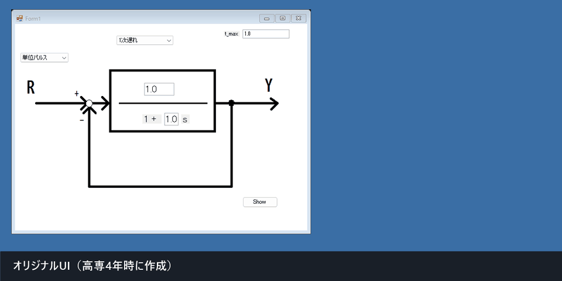
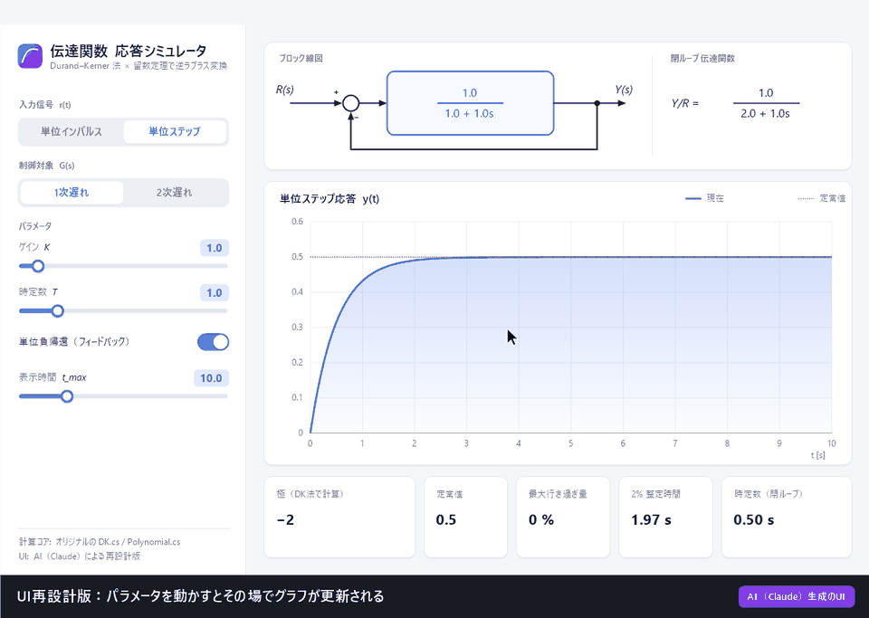
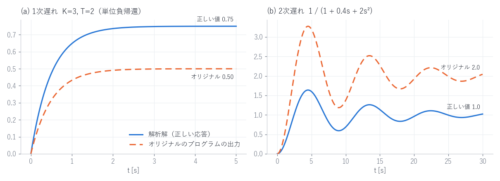

# 伝達関数 応答シミュレータ（dentastu）

伝達関数で表した制御系に単位インパルス・単位ステップを入力したときの時間応答 $y(t)$ を計算し、グラフに描く Windows アプリです。
**高専4年（2023年9〜10月）** に、制御工学と数値計算の勉強のために作りました。

逆ラプラス変換には数値計算ライブラリを使っていません。
分母多項式の根（極）を **Durand–Kerner 法** で求め、**留数定理** で時間関数に戻す処理を自分で実装しました。
最初に C++ でアルゴリズムを確認し、そのあと C# (WinForms) に移植して GUI を付けています。

| 項目 | 内容 |
|---|---|
| 言語 | C++ (アルゴリズムの検証)、C# / .NET Framework 4.7.2 (GUI アプリ) |
| 使ったもの | 複素数型 (`std::complex`, `System.Numerics.Complex`) と標準ライブラリだけ |
| 学んだこと | 伝達関数・ラプラス変換、多項式の求根アルゴリズム、クラス設計、Windows Forms |

---

## デモ

### オリジナル版（高専4年時に作成）



入力信号と系（1次遅れ／2次遅れ）を選んで係数を入れ、`Show` を押すと別ウィンドウに応答のグラフが出ます。
この GIF は、当時ビルドした `dentastu.exe` の画面 (`Form1` / `Form3`) をプログラムから操作して撮ったもので、画面には手を加えていません。

### UI再設計版（⚠ AI が生成）

> [!IMPORTANT]
> **このセクションの UI と GIF は AI（Anthropic の Claude）が生成しました。** 私自身が作ったものではありません。
> オリジナル版の UI が見づらかったので、「今ならどう見せるか」の参考として作ってもらいました。
> 根の計算には、オリジナルの [`DK.cs`](dentastu/DK.cs) と [`Polynomial.cs`](dentastu/Polynomial.cs) を**一切変更せずに**使っています。
> UI のコードと、留数計算を書き直した [`ResponseModel.cs`](dentastu_redesign/src/ResponseModel.cs) は AI が書いたものです。



主な変更点:

- 1つのウィンドウにまとめ、スライダーを動かすとグラフがすぐ更新されるようにした
- ブロック線図・閉ループ伝達関数の表示がパラメータに連動する
- 変更前の応答を灰色の破線で残すので、パラメータの影響を見比べられる
- 極（DK 法で計算）・定常値・最大行き過ぎ量・2% 整定時間・減衰比 ζ / 固有角周波数 ωn を表示する
- 後述の [考察](#考察) で挙げた計算上の問題を直した

---

## 仕組み

### 1. 出力のラプラス変換を多項式で表す

入力 $R(s)$ はインパルスなら $1$、ステップなら $1/s$ です。どちらの場合も出力は

```math
Y(s) = G(s)R(s) = \frac{N(s)}{D(s)}
```

の形になります。分母 $D(s)$ は、系の分母多項式と入力の $s$ を掛けたものです。この掛け算は自作の `Polynomial.Multiplication` で行います。

### 2. 分母の根を Durand–Kerner 法で求める

$n$ 次多項式 $D(s)=a_n\prod_i (s-p_i)$ の根 $p_1,\dots,p_n$ を、次の式を繰り返して全部同時に求めます。

```math
z_i^{(k+1)} = z_i^{(k)} - \frac{D\left(z_i^{(k)}\right)}{a_n \prod_{j \ne i} \left(z_i^{(k)} - z_j^{(k)}\right)}
```

初期値には Aberth の初期値（根の重心 $\beta = -a_{n-1} / (n a_n)$ を中心とする円周上に並べた点）を使っています（[`DK.SetInitialValue`](dentastu/DK.cs)）。

### 3. 留数定理で時間応答に戻す

極がすべて単根なら、逆ラプラス変換は留数の和として書けます。

```math
y(t) = \sum_i \mathrm{Res}_{s=p_i} \left[ Y(s) e^{st} \right]
     = \sum_i \frac{N(p_i)}{a_n \prod_{j \ne i} (p_i - p_j)} e^{p_i t}
```

この $y(t)$ を時刻ごとに計算して、グラフに描きます。

---

## 開発の流れとファイル構成

C++ で求根アルゴリズムを確認してから、C# に移植して GUI を付けました。

```
denntastukansuu/
├── DK.cpp              ① 4次式 (z-1)(z-2)(z-3)(z-4) の根を DK 法で求める最初の試作
├── DKA.hpp / DKA.cpp   ② 任意の次数に対応した DK クラス。係数をファイルから読み、根をファイルに書く
├── test_DKA.cpp           (input.txt → output.txt)
├── Polynomial.hpp/.cpp ③ 多項式の加算・乗算クラス
├── main.cpp               (Polynomial のテスト)
├── dentastu/           ④ C# (WinForms) 版 ─ オリジナルの GUI アプリ
│   ├── DK.cs                 DK 法（C++ 版の移植）
│   ├── Polynomial.cs         多項式クラス（C++ 版の移植）
│   ├── LagElement.cs         留数計算で y(t) を求める
│   ├── FirstOrderLagElement.cs  1次遅れ専用の旧実装（Form2 と一緒に使っていた）
│   ├── Form1.cs              入力画面（ブロック線図の背景画像の上にテキストボックスを配置）
│   └── Form3.cs              グラフ描画画面
├── dentastu_redesign/  ⑤ [AI生成] UI再設計版
│   ├── build.bat             csc.exe でビルド（Visual Studio 不要）
│   └── src/                  MainForm.cs, Widgets.cs, ResponseModel.cs
└── docs/               README 用の GIF・図
```

`result.csv` は `FirstOrderLagElement` が出力した、1次遅れ系（K=1, T=1）のステップ応答 $0.5(1-e^{-2t})$ の数値です。理論値と一致していることを確認するのに使いました。

## 動かし方

**オリジナル版**: `dentastu/dentastu.sln` を Visual Studio で開いてビルドし、実行します。

**UI再設計版（AI生成）**: Windows 標準の .NET Framework 4.x に入っている `csc.exe` でビルドします。

```bat
dentastu_redesign\build.bat
dentastu_redesign\bin\dentastu_redesign.exe
```

**C++ 版**: VS Code のタスク (`cl.exe`) か、Developer Command Prompt から次のようにビルドします。

```bat
cl /EHsc test_DKA.cpp DKA.cpp
test_DKA.exe   :: input.txt に係数を昇べき順で 1 行ずつ書く（例: -3, 2, 1 → z²+2z-3）
```

---

## 考察

当時のコードを読み直し、実際に動かして振り返りました。

### うまくいった点

- **数値計算を自分で実装した**: ライブラリに頼らずに「多項式 → 根 → 留数 → 時間応答」の流れを実装したことで、ラプラス変換が式の上だけでなく計算手順として理解できた。
- **段階を踏んで作った**: まず固定の4次式で DK 法を試し、次に任意次数のクラスにして、ファイル入出力を付け、最後に C# に移植して GUI を付けた。それぞれの段階で動作を確認しながら進められた（C++ 版で $z^2+2z-3$ の根 $1, -3$ や、$(z-1)(z-2)(z-3)(z-4)$ の根が正しく求まることを確認済み）。
- **DK 法は精度が高い**: 同じ DK クラスを使った UI再設計版で解析解と比べたところ、1次遅れ・2次遅れとも誤差は $10^{-15}$ 程度だった。理論上は苦手なはずの重根（$0.5(s+2)^2$）でも、誤差は $3\times10^{-9}$ に収まった。

### 計算の問題点：初期値のままだと気づけないバグ

当時のプログラムに $K=3,\ T=2$ などを入力して、解析解と比べてみました。オレンジの破線が当時のプログラムの出力、青の実線が正しい応答です。



原因は3つありました。

1. **留数の分母で最高次係数 $a_n$ を掛けていない**
   [`LagElement.dFunc`](dentastu/LagElement.cs#L80) は `sum = 1.0` から積を始めています。このため、分母がモニック（最高次係数が 1）でないと、応答全体が $1/a_n$ 倍にずれます。図 (b) では $b=2$ なので、応答が 2 倍になっています。
2. **ゲイン $K$ が分子に入っていない**
   [`Form1.cs`](dentastu/Form1.cs#L79) で分子を `{ 1.0 }` に固定しているので、$K$ は分母の $1+K$ にしか効きません。`LagElement` に `gein` を渡してはいますが、計算では使っていません。
3. **2次遅れでは、ブロック線図にあるフィードバックとゲインが計算に入っていない**
   2次遅れ側の分母は `{1, a, b}` のまま（[Form1.cs:91](dentastu/Form1.cs#L91)）で、画面のブロック線図と計算内容が合っていません。

1次遅れの初期値 $K=1,\ T=1$ では、$K=a_n=1$ なので 1・2 の影響が表に出ず、正しい応答 $0.5(1-e^{-2t})$ と一致します。
当時は初期値のまま動作確認していたので、バグに気づけませんでした。
**解析解が分かる入力をいくつか用意し、自動で比べるテストを作っておくべきだった**というのが一番の反省です。
1次遅れ専用の旧実装 `FirstOrderLagElement` は $K/T$ を分子に入れていて正しかったので、汎用化するときに入れたバグだと考えられます。

### 数値計算として改善できる点

- **初期値の半径が固定**: `SetInitialValue(5)` は、根の絶対値が 5 を大きく超えると収束が遅くなります（例: $T=0.1, K=10$ だと極は $-110$）。UI再設計版では、Cauchy の上界 $r = 1+\max_i|a_i/a_n|$ を半径にしています。
- **収束判定がない**: 反復回数を 100 回に固定しています。残差 $|D(z_i)|$ や更新量で止めるようにすれば、速さと信頼性の両方が上がります。
- **重根の扱い**: 留数の式は単根を前提にしています。今回の検証では数値的に問題ありませんでしたが、理論的には重根の判定と、重根用の留数の式が必要です。

### C++ 版のメモリ管理

`main.exe`（Polynomial のテスト）を実行すると、何も出力せずに **ヒープ破損 (0xC0000374)** で異常終了します。

- `Polynomial` は生ポインタを持っているのに、コピーコンストラクタも代入演算子も定義していません（Rule of Three 違反）。値渡しでコピーした引数と元のオブジェクトが、同じ配列を共有します。
- そのうえ `Addition` / `Multiplication` の中で引数の配列を `delete[]` しているので（[Polynomial.cpp:84](Polynomial.cpp#L84)）、デストラクタで二重解放が起きます。
- `Polynomial(int n)` や `DK(int n, double coef[], int ite)` のコンストラクタは、未初期化のポインタを残したり、係数配列を確保しなかったりします。

C# に移植したときは GC がこれらの問題を隠してくれましたが、C++ なら `std::vector` を使って RAII に任せるのが正解でした。

### UI・描画の問題点

GIF のとおり、オリジナル版の UI は次の点で使いにくいものでした。

- **点で描いている**: `SetPixel` で1ピクセルずつ描いているので、立ち上がりのように傾きが急な部分が途切れて点線になります（[Form3.cs:89](dentastu/Form3.cs#L89)）。
- **座標がハードコード**: 軸の目盛りの位置が `i * 160`、`240` のような固定値です。また x 軸を画面の中央に置いているので、ステップ応答だと下半分が空白になります。
- **最大値の求め方に誤り**: `if (Abs(y) > max) max = y;` と書いているので、負の値で最大値を更新すると目盛りが壊れます（[Form3.cs:72](dentastu/Form3.cs#L72)）。
- **入力チェックがない**: `double.Parse` をそのまま使っているので、数値以外を入力すると例外で落ちます。`Show` を押すたびに新しいウィンドウが増えていきます。
- **名前が意味を表していない**: `Form1`/`Form3`、`comboBox1`、`gein` など、名前から役割が読み取れません。

UI再設計版（AI生成）を見て、特に参考になったのは次の2点です。

- **計算とUIを分ける**: 計算部分 (`ResponseModel`) と描画を分けたことで、テストしやすくなっています。
- **値を変えたらすぐ見えるようにする**: 制御工学の学習用ツールとしては、パラメータを変えた結果がその場で分かることのほうが、きれいな見た目よりも大事だと感じました。

### まとめ

自分で実装したことで、数値解法を理解して動かすところまではできました。
一方で、**正しいことを確かめる仕組み（テスト）** と **使う人のことを考えた見せ方（UI）** が欠けていました。
今作り直すなら、次の3つを最初にやります。

1. 解析解と比べるユニットテストを先に書く
2. 計算と UI を分ける
3. C++ では `std::vector` などで所有権を明確にする

---

## AI の利用について

| 対象 | 作成者 |
|---|---|
| `*.cpp` / `*.hpp`、`dentastu/` 以下のコード（オリジナル版） | 本人（高専4年時） |
| `dentastu_redesign/` 以下のコード、`docs/redesign.gif` | **AI（Claude）が生成** |
| `docs/original.gif`（オリジナル版の画面を自動操作して撮影）、`docs/bug_comparison.png` | AI（Claude）が作成 |
| この README（分析・考察の文章を含む） | AI（Claude）が作成 |
